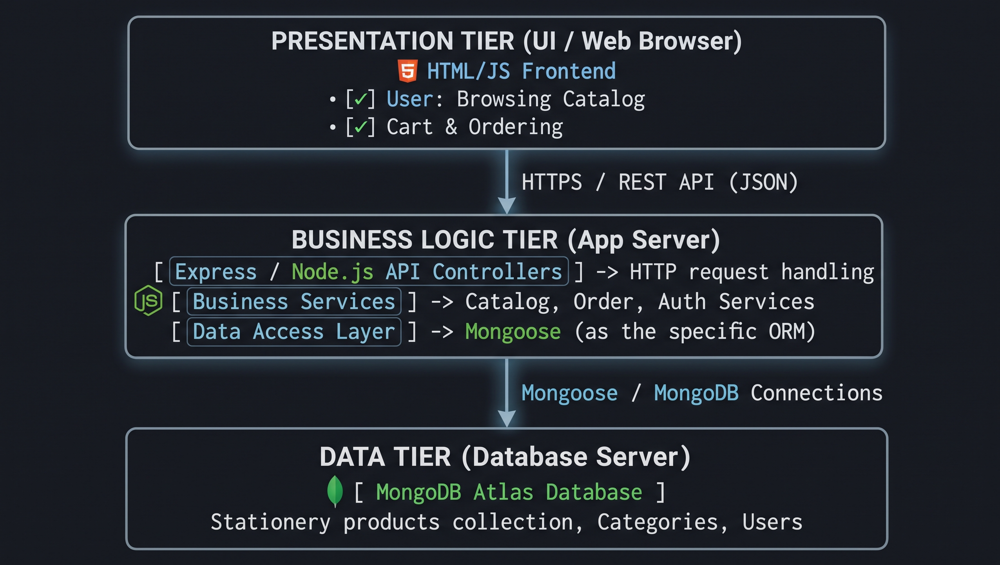
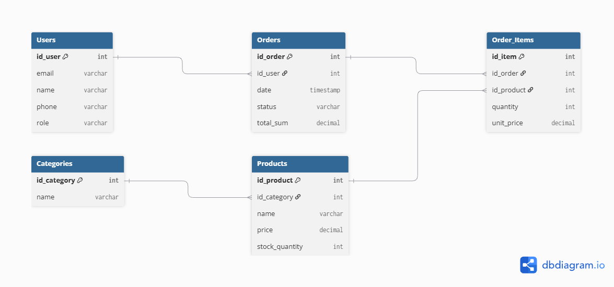
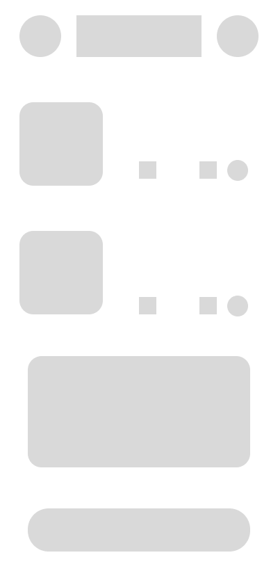
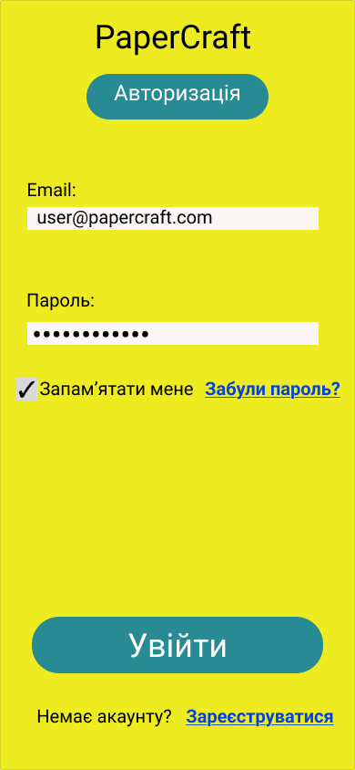
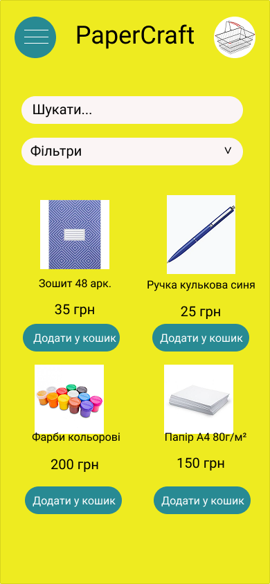
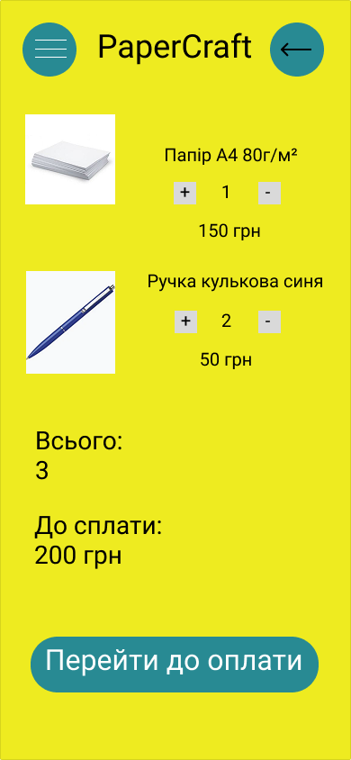
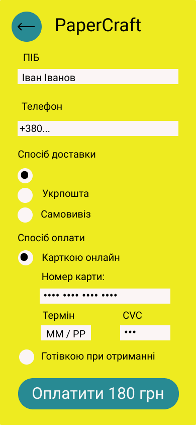

# Матеріали лабораторної роботи №3 (Проектування)

### Архітектурний стиль та архітектурна діаграма
Для проекту PaperCraft обрано RESTful API архітектуру з трьохрівневою структурою (Client-Server-Database). Клієнтська частина взаємодіє з сервером Node.js/Express через HTTP-запити, а сервер здійснює операції над базою даних MongoDB Atlas. Це забезпечує високу масштабованість, гнучкість та чіткий поділ відповідальностей між модулями.

### ER-діаграма моделі даних
ER-діаграма описує структуру сутності канцтоварів (Stationery) у базі даних MongoDB. Кожен документ містить поля для унікального ідентифікатора (_id), назви, категорії, ціни та прапорця наявності на складі. Модель даних розроблена з урахуванням гнучкості документо-орієнтованих БД для швидкої вибірки та оновлення каталогу.

### Каркас та макет UX/UI
Каркас (Wireframe) визначає базове розташування елементів інтерфейсу онлайн-магазину канцтоварів. Макет (Mockup) демонструє фінальний графічний дизайн, колірну гаму та структуру картки товару. Інтерфейс орієнтований на зручність користувача при перегляді та фільтрації товарів.

#### Wireframes:

#### Mockups:

